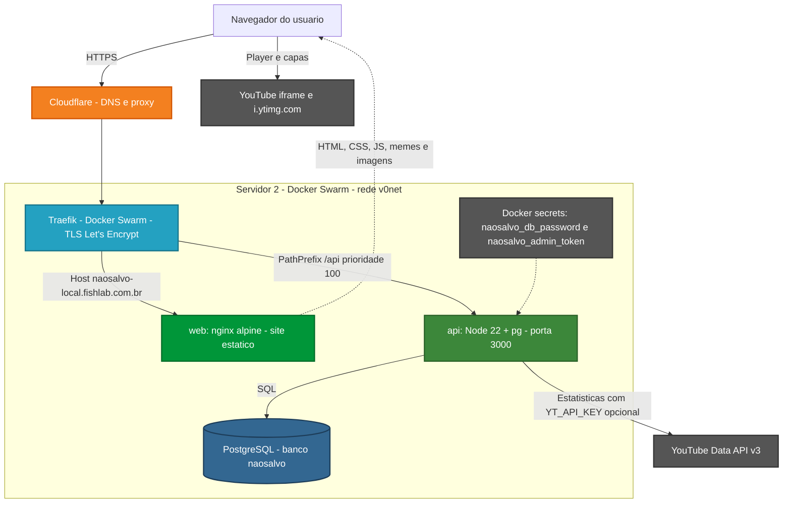
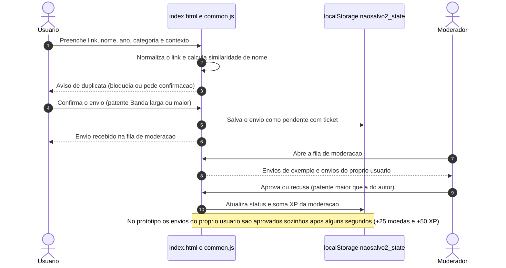
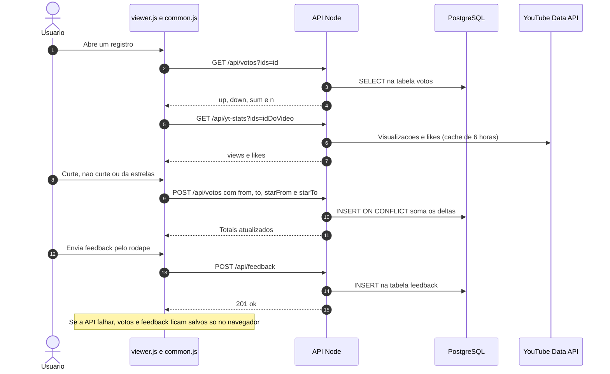
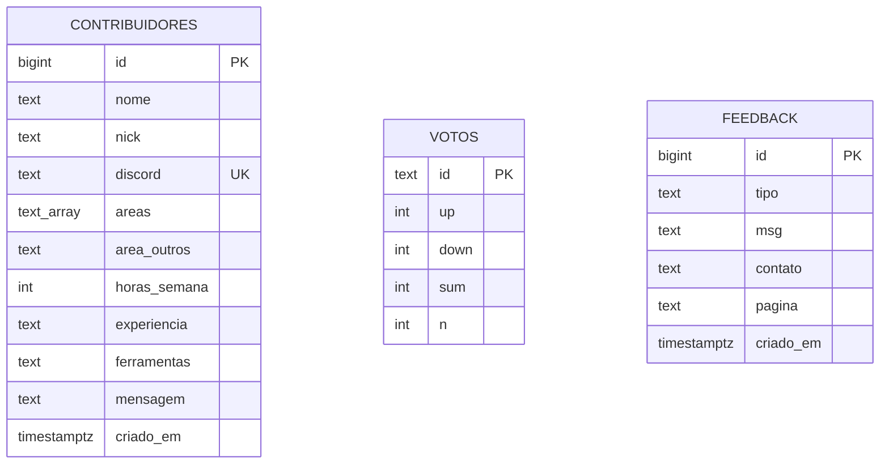
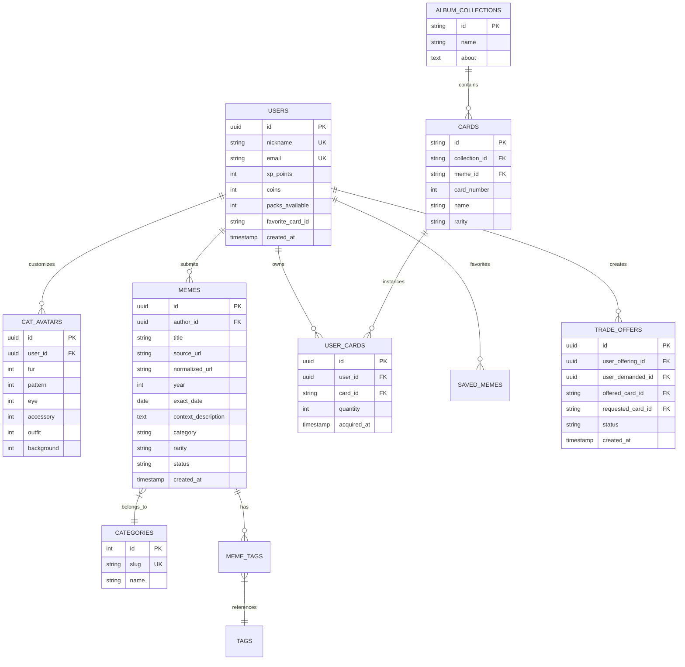

# 🏛️ Xixa 2 — Museu & Arquivo da Internet Brasileira

> *"E no fim, o plano do Não Salvo era salvar."*

O **Não Salvo** é uma plataforma colaborativa dedicada a catalogar, preservar e celebrar a história viva dos memes, virais e da cultura digital brasileira desde 2004 até a atualidade.

Este projeto nasceu da união da comunidade (comunidade XET, Cid Cidoso, moderadores e voluntários) para criar uma experiência rica que mistura acervo histórico, linha do tempo interativa e gamificação através de um álbum de figurinhas digital.

> **Estado atual (25/11/2026):** o layout e as telas do protótipo de [@Subversivo011](https://github.com/Subversivo011) são a **raiz do site** (HTML/CSS/JS estático, sem build), ligado a uma **API real em Node + PostgreSQL** (`api/`, 26 migrações). O **servidor é a autoridade**: login com Discord (sessão em cookie e CSRF), moedas, XP, pacotes e cartas, votos por usuário, envios e moderação por consenso, ranking, Memepédia, perfil público, painel admin (`seppzone/`), analytics anônimo de navegação, imagens no S3 (otimizadas para WebP) e um **servidor MCP** (`/mcp`, 16 ferramentas) para cadastrar memes, cartas e verbetes da Memepédia por um assistente de IA. O acervo tem **283 memes** e **603 cartas em 11 coleções**. O estado do plano está em [`docs/PLANO-IMPLEMENTACAO.md`](docs/PLANO-IMPLEMENTACAO.md); as rotas, em [`docs/API.md`](docs/API.md).
>
> Algumas seções mais abaixo ainda descrevem o protótipo original (por exemplo, diagramas e a lista de arquivos). Onde houver divergência, vale este aviso e o plano de implementação.

---

## 📌 Sumário
- [1. Visão Geral e Funcionalidades (MVP)](#1-visão-geral-e-funcionalidades-mvp)
- [2. Mapas e Diagramas Mermaid](#2-mapas-e-diagramas-mermaid)
  - [2.1. Mapa de Telas e Navegação](#21-mapa-de-telas-e-navegação)
  - [2.2. Arquitetura do Sistema e Infraestrutura](#22-arquitetura-do-sistema-e-infraestrutura)
  - [2.3. Fluxos: Envio de Vídeo, Votos e Feedback](#23-fluxos-envio-de-vídeo-votos-e-feedback)
  - [2.4. Modelo de Dados (ER Diagram)](#24-modelo-de-dados-er-diagram)
- [3. Stack Tecnológica e Dimensionamento](#3-stack-tecnológica-e-dimensionamento)
- [4. Estrutura de Diretórios](#4-estrutura-de-diretórios)
- [5. Regras de Negócio e Curadoria](#5-regras-de-negócio-e-curadoria)
- [6. Referências de Design e Mockups](#6-referências-de-design-e-mockups)
- [7. Formulário de Contribuidores, Dashboard e API](#7-formulário-de-contribuidores-dashboard-e-api)

---

## 1. Visão Geral e Funcionalidades (MVP)

### 🗓️ 1. Hoje na História da Internet
- O bloco **"Hoje na história da web"** (home) pega a data atual e mostra o registro do acervo cuja data (dia e mês) é a mais próxima de hoje, com "Há X anos" e o botão *Relembrar*.
- Botão **Aleatório** abre um registro qualquer do acervo.
- Ao lado fica o bloco **sobe.desce** (ranking de memes mais abertos e mais tocados, hoje ou de todos os tempos, a partir de `/api/sobedesce`) e **Últimos adicionados** (os 5 mais recentes, com atalho para a fila de moderação).

### ⏱️ 2. Linha do Tempo Histórica (2004 - Presente)
- Navegação ano a ano (2004 a 2019 e **2020+**) com lema e resumo cultural de cada época (`YEAR_INFO`). Setas `←`/`→` do teclado e botões laterais trocam de ano; os 3 registros mais vistos do ano aparecem como destaque e, se faltarem, entram cartões "Salvar um viral de AAAA".
- Grade de registros com busca (ignora acentos) e filtros por categoria: Vídeos, TV, Música, Cultura, Zoeira, Fotos e Esportes (também pelo menu **Categorias**).
- Classificação do acervo por raridade cultural: *Clássico*, *Relíquia*, *Lendário* e *Mítico*. A seção **Clássicos da internet brasileira** destaca os Míticos.
- O acervo (`data.js`) tem **283 registros** (de 1989 a 2026): 257 com vídeo do YouTube, 75 com capa local em `memes/` e 1 com vídeo só no Facebook (campo `fb`). O Postgres também guarda o acervo (carregado por `api/seed/acervo.js` e pelas migrações), e novos memes entram pelo painel admin ou pelo MCP.

### 🎞️ 3. Tela de Vídeo e Foto no Visual de Cada Época
Ao abrir um registro, o site mostra uma página no estilo da época do meme (`viewer.js` + `viewer.css`), com o player do YouTube (`player.js`), vídeos relacionados, link para "Ver o ano" e a opção de **salvar o link** de virais que ainda estão sem vídeo (+5 moedas, exige patente Colaborador).

| Tipo | Faixa de ano | Visual |
|---|---|---|
| Vídeo | 2004 | E-mail encaminhado + Reprodutor de Mídia (janela estilo Windows XP, conexão discada) |
| Vídeo | 2005 a 2007 | YouTube de 2005 a 2007 |
| Vídeo | 2008 a 2009 | YouTube de 2008 a 2009 |
| Vídeo | 2010 a 2012 | YouTube de 2010 a 2012 |
| Vídeo | 2013 a 2016 | YouTube de 2013 a 2016 (com "A seguir") |
| Vídeo | 2017 em diante | YouTube atual |
| Foto | até 2006 / 2007 a 2011 / 2012 a 2014 / 2015 / 2016 em diante | Fotolog / Orkut / Tumblr / Instagram de 2015 / Instagram atual |

- **Nota do público:** estrelas (2004 a 2009) ou curtir/não curtir (2010 em diante). Votar exige login e vale um voto por pessoa (`/api/votos`, tabela `votos_usuario`); o `GET` com os totais é público. As visualizações reais vêm de `/api/yt-stats`.
- **Sons da época** (modem discado, aviso do MSN, pop do scrap), gerados na hora pelo Web Audio, com botão para ligar e desligar.
- Atalhos: `Esc` fecha o registro e a tela inicial aceita `←`/`→` para trocar de ano.

### 🃏 4. Álbum de Figurinhas da Internet (Gamificação)
Página própria (`album.html`) com três colunas: **Minhas coleções** (barra lateral com progresso, total de cartas, raridades e carteira de moedas), **Fichário** (cartas da coleção, 6 por página, com paginação e `←`/`→`) e **Detalhe da carta**. O menu da página tem *Início, Coleções, Loja, Converter repetidas e Ranking*. O estoque, as cartas e as moedas ficam no servidor, ligados à conta (`/api/album`, `/api/pacotes/*`, `/api/carteira`).

**11 coleções (603 cartas):**

| Coleção | Cartas |
|---|---|
| Lendas do Orkut | 27 |
| Lendas da Web | 7 |
| Expansão Orkut | 34 |
| Comunidades Clássicas | 76 |
| Plataformas Raiz | 111 |
| Blogs & Épicos | 84 |
| Sites & Portais | 38 |
| Lendas do Fotolog | 19 |
| YouTube Raiz | 83 |
| Redes & Trends | 96 |
| Grupinhos e Criadores | 28 |

A coleção "Memes Icônicos" saiu na migração 021: as cópias que cada pessoa tinha viraram moedas. Cada coleção tem texto "Sobre a coleção" e tabela de cartas por raridade. As cartas mostram a imagem enviada no painel (S3) quando existe, senão a capa do YouTube e, por fim, o emoji. Cartas ainda não tiradas aparecem como silhueta com `???`. Completar uma coleção dá **+100 moedas** e **+100 XP**.

**6 raridades** (moedas e chances iguais aos do documento de economia):

| Raridade | Cartas | Chance por carta no pacote | XP (carta nova) | Moedas (repetida) | Efeito visual |
|---|---|---|---|---|---|
| Comum | 116 | 44% | 2 | 5 | Moldura cinza |
| Relevante | 31 | 26% | 4 | 10 | Moldura verde |
| Raro | 174 | 15% | 8 | 20 | Moldura azul |
| Relíquia | 162 | 9% | 15 | 40 | Moldura roxa + brilho holográfico |
| Lendário | 86 | 5% | 30 | 80 | Moldura dourada + brilho holográfico |
| Mítico | 34 | 1% | 60 | 150 | Moldura vermelha + brilho holográfico + pulso |

*(A coluna "Cartas" é a contagem real de `data.js`; os valores de XP e moedas ficam na tabela `regras_economia` e as chances, em `pacotes_tipo`.)*

Dentro da mesma raridade, todas as cartas têm a mesma chance. A chance de uma carta específica aparece no painel de detalhe.

**Pacotes (5 cartas cada), guardados num estoque de pacotes fechados:**

| Pacote | Preço | Regra |
|---|---|---|
| Pacote Diário | Grátis | 1 por dia em que você entra no site; acumula até 7 |
| Boas-vindas | Grátis | 1 vez, no primeiro acesso. Garante 1 carta Rara ou melhor |
| Pacote Clássico | 150 moedas | 5 cartas de todas as coleções, chances padrão |
| Pacote da Coleção | 200 moedas | 5 cartas só da coleção escolhida na loja |
| Pacote Ouro | 450 moedas | Sem Comuns (Relevante 30, Raro 38, Relíquia 19, Lendário 10, Mítico 3 por cento). Garante 1 Relíquia ou melhor |

- **Estoque e botão de pacotes:** um botão flutuante mostra quantos pacotes estão esperando. Com 1 pacote ele abre direto; com vários, abre a lista "Seus pacotes". Sem pacotes, leva à loja.
- **Animação de abertura:** o pacote flutua, balança ao passar o mouse e é rasgado com um clique; as cartas aparecem viradas para baixo, são reveladas uma a uma (ou todas em *Revelar tudo*), com faíscas na cor da raridade para Relíquia ou melhor, selo **NOVA!** e resumo (novas, XP, valor das repetidas, coleções completas).
- **Loja de pacotes:** cartões com as chances por raridade, saldo, tabela *Como ganhar moedas* e atalho para converter repetidas.
- **Repetidas viram moeda:** botão *Converter repetidas* (todas) ou *Converter 1 repetida* no detalhe da carta. Fica sempre 1 cópia de cada.
- **Carta favorita** (estrela), **compartilhar** (copia um texto) e **Ranking de colecionadores** (`/api/ranking?metrica=cartas`).
- **Painel do perfil:** clicar na carteira do cabeçalho mostra moedas, XP, patente e envios aprovados, que vêm do servidor.
- **Troca de cartas entre usuários:** ainda não existe (planejado para o backend, ver `docs/subversivo011/economia-e-escassez.md`).

**Economia e escassez:** a análise da economia do álbum (chances, preço do pacote, simulação de quanto tempo cada perfil leva para completar, diagnóstico e recomendações de game design) está em [`docs/subversivo011/economia-e-escassez.md`](docs/subversivo011/economia-e-escassez.md), com o simulador em [`docs/subversivo011/simulacao.js`](docs/subversivo011/simulacao.js). Ela foi feita com o catálogo antigo (109 cartas e 8 coleções, hoje são 603 cartas e 11 coleções) e supõe um único pacote comprado a 150 moedas; o Pacote Clássico custa 150 e o Ouro, 450. Os números do simulador precisam ser refeitos para o catálogo atual.

### 🐱 5. Criador de Gatinho (Avatar) e Conta
A entrada é **só pelo Discord** (OAuth2, em `entrar.html`; não existe cadastro por e-mail e senha nem login com Google). A sessão fica num cookie `httpOnly`, com proteção CSRF. Na primeira vez a pessoa escolhe o apelido (3 a 20 caracteres: letras, números, `_`, `.`, `-`) e monta o **gatinho** (prévia grande, raça e botão *Embaralhar tudo*); salvar o gato pela primeira vez completa o cadastro e dá o pacote de boas-vindas. O gato é um SVG gerado na hora e é o mesmo no cabeçalho, no ranking e no perfil. Quem quiser pode mostrar a foto do Discord no lugar do gato.

O criador tem 4 abas (os limites são `OPCOES_GATO` em `api/auth/perfil.js`; opções novas entram sempre no fim, porque o gato salvo guarda o índice):
1. **Pelo:** 15 cores de pelo (a **Rosa** vira um gato **Sphynx**, sem pelo, com orelhas grandes e rugas), 9 padrões (Liso, Tigrado, Pintado, Smoking, Máscara, Tartaruga, Tricolor, Siamês e Peludo; os padrões ficam desativados no Sphynx) e 8 cores de olhos (inclui heterocromia).
2. **Acessórios (opcional):** 18 opções, entre óculos, boné, gorro, fone, bandana, coroa, cartola, laço e outros, com ícones desenhados.
3. **Roupa (opcional):** 14 opções, de hoodie e jaqueta a camisa canarinho, terno e suéter de tricô, ou sem roupa.
4. **Fundo:** 8 fundos em degradê (Azul, Roxo, Rosa, Verde, Sol, Noite, Menta e Vermelho).

O cabeçalho mostra o gato, o nome e *Gato nível N* (nível = posição da patente). Conta, avatar, XP e moedas ficam no servidor.

### 🏆 5.1. Ranking & Patentes
- **Ranking da galera** (home, menu *Ranking*): lista ordenada por XP, calculada pelo servidor a partir do razão de XP (`GET /api/ranking?metrica=xp`).
- **Ranking de colecionadores** (álbum): por cartas coletadas (`metrica=cartas`).
- **6 patentes por XP**, e quem tem patente maior modera quem tem menor:

| Patente | XP | O que libera |
|---|---|---|
| Discado | 0 | Navegar no acervo, abrir pacotes e colecionar cartas |
| Banda larga | 150 | Enviar vídeos para o acervo |
| Colaborador | 500 | Salvar o link de virais antigos que estão sem vídeo |
| Moderador | 1.500 | Moderar envios de quem tem patente menor |
| Dono de comunidade | 4.000 | Selo dourado no perfil e voto de minerva na moderação |
| Lenda da internet | 10.000 | Selo vermelho de lenda |

- **Como ganhar XP:** visita diária +10, abrir pacote +5, carta nova (2 a 60 conforme a raridade), envio aprovado +50, link antigo salvo +10, coleção completa +100 e cada moderação +15.

### ☁️ 6. Envio de Vídeos, Anti-Duplicação e Moderação
Os envios e a fila têm backend real (`api/routes/envios.js`): `POST /api/envios`, `GET /api/envios/meus`, fila em `/api/mod/fila` e pedidos de remoção em `/api/remocoes`, com prazo de 72 h. **Dois votos iguais fecham o envio**; votos divididos esperam o desempate de um admin; as recompensas entram no razão de moedas e XP.
- **Enviar vídeo** (exige conta e patente Banda larga): link original (YouTube, TikTok, X, Instagram), nome, ano, categoria e contexto ("Conta pra quem não viveu"). Quem ainda não tem a patente vê uma tela explicando como ganhar XP.
- **Anti-duplicação em tempo real:** o link é normalizado (YouTube, TikTok, X e Instagram viram um id) e comparado com acervo e fila; o nome é comparado por similaridade. Igual ou muito parecido bloqueia o envio; parecido pede confirmação.
- **Fila de moderação:** envios reais de outros usuários, com aviso de possível duplicata; aprovar e recusar ficam liberados só para quem pode moderar.
- **Recompensas:** envio aprovado = +25 moedas e +50 XP; link antigo salvo = +5 moedas e +10 XP.

### 💬 7. Rodapé, Feedback e Aviso Legal
- Botão **"fala que eu te escuto"** abre o formulário de feedback (tipos: Ideia, Bug, Elogio e Remoção), enviado para `POST /api/feedback`. Se a API estiver fora do ar, a mensagem fica salva no navegador (`ns_feedback`).
- **Aviso legal:** o site não hospeda vídeos; todos são exibidos pelo player oficial do YouTube. Donos de conteúdo podem pedir remoção pelo próprio formulário.

### 🌗 8. Tema Claro e Escuro
Interruptor no cabeçalho alterna entre **claro** (padrão) e **escuro**, lembrado em `localStorage` (`ns_theme`). Os tokens estão em `theme.css`.

---

## 2. Mapas e Diagramas Mermaid

### 2.1. Mapa de Telas e Navegação

```mermaid
flowchart TD
    classDef main fill:#0d1838,stroke:#3d86ff,stroke-width:2px,color:#fff;
    classDef modal fill:#1f1338,stroke:#a46bff,stroke-width:1px,color:#fff;
    classDef auth fill:#1a233a,stroke:#25d07a,stroke-width:1px,color:#fff;
    classDef ext fill:#2a2a2a,stroke:#999999,stroke-width:1px,color:#fff;

    Start(["Visitante acessa o site"]) --> Home["index.html: Home do acervo"]:::main

    subgraph Home_Secoes ["Home (index.html)"]
        Home --> Hero["Hero e Classicos da internet"]:::main
        Home --> Today["Hoje na historia da web e sobe.desce"]:::main
        Home --> Latest["Ultimos adicionados"]:::main
        Home --> Timeline["Linha do tempo 2004 a 2020+"]:::main
        Home --> Browse["Grade de registros com busca e categorias"]:::main
    end

    Home -->|Menu Album de figurinhas| Album["album.html: Album"]:::main
    Home -->|Criar conta / Entrar| Signup["Modal: Conta e criador do gatinho"]:::auth
    Home -->|Rodape| Feedback["Modal: Feedback"]:::modal
    Home -->|Rodape: Quero contribuir| Contribuir["contribuir/: Formulario de contribuidores"]:::ext
    Dashboard["dashboard/: Painel admin com token"]:::ext

    subgraph Modais_Home ["Modais da Home"]
        Timeline -->|Clique no ano| YearPick["Troca de ano e destaques"]:::modal
        Browse -->|Clique no registro| Viewer["Viewer: video ou foto no visual da epoca"]:::modal
        Today --> Viewer
        Latest --> Viewer
        Viewer -->|Salvar link de viral antigo| SaveLink["Colaborador: salvar link e ganhar moedas"]:::modal
        Home -->|Enviar video| Submit["Modal: Enviar video com anti-duplicacao"]:::modal
        Home -->|Moderacao| Mod["Modal: Fila de moderacao"]:::modal
        Home -->|Ranking| Rank["Modal: Ranking da galera e patentes"]:::modal
        Home -->|Carteira| Perfil["Modal: Perfil e modo teste"]:::modal
    end

    subgraph Album_Telas ["Album (album.html)"]
        Album --> Cols["Minhas colecoes e Fichario"]:::main
        Album --> Det["Detalhe da carta"]:::main
        Album --> Shop["Modal: Loja de pacotes"]:::modal
        Album --> Inv["Modal: Seus pacotes"]:::modal
        Inv --> Open["Modal: Abertura do pacote"]:::modal
        Album --> RankCol["Modal: Ranking de colecionadores"]:::modal
        Det -->|Assistir no player| Viewer
    end

    Viewer -->|Votos e visualizacoes| ApiVotos["API: /api/votos e /api/yt-stats"]:::ext
    Feedback -->|POST| ApiFeed["API: /api/feedback"]:::ext
```



> Rotas: não há roteador. A home aceita âncoras (`index.html#2012`, `#2020mais`, `#rank`, `#mod`, `#send`, `#rand`, `#tl`, `#todos`), usadas pelos links do rodapé e do álbum. `/contribuir/`, `/dashboard/` e `/admin/` são páginas separadas.

---

### 2.2. Arquitetura do Sistema e Infraestrutura



> O nginx (`deploy/nginx.conf`) só serve arquivos estáticos (e `noindex` em `/dashboard/` e `/admin/`); o Traefik é quem separa `/api` para o serviço Node. A imagem do site (`Dockerfile`) não leva `api/`, `docs/`, `README.md` nem `memes_data.json` (ver `.dockerignore`).

---

### 2.3. Fluxos: Envio de Vídeo, Votos e Feedback

**Envio e moderação (protótipo, 100% no navegador):**



**Votos, visualizações e feedback (backend real):**



---

### 2.4. Modelo de Dados (ER Diagram)

**Tabelas que existem hoje no PostgreSQL `naosalvo`** (criadas pela API na primeira subida, sem relacionamentos entre si):



- `contribuidores.discord` tem índice único em minúsculas. `areas` é um array de texto.
- `votos.id` é o id do registro do acervo (`[a-z0-9-]`); `up` e `down` contam curtidas e não curtidas, e `sum` e `n` são a soma e a quantidade de estrelas (média = `sum / n`). Os votos são anônimos (sem usuário).
- `feedback.tipo` assume `ideia`, `bug`, `elogio` ou `remocao`.

**Modelo planejado para quando contas, álbum e trocas forem para o backend** (hoje tudo isso vive no `localStorage`; não existe no banco):



---

## 3. Stack Tecnológica e Dimensionamento

### 🚀 Stack em uso hoje
| Componente | Tecnologia | Papel Principal |
| :--- | :--- | :--- |
| **Front-end** | HTML, CSS e JavaScript puro (sem build, sem framework) | Páginas estáticas: `index.html`, `album.html`, `linha-do-tempo.html`, `memepedia.html`, `perfil.html`, `entrar.html`, `404.html`, `contribuir/`, `dashboard/` e o painel `seppzone/`. Fontes Rajdhani, Inter e Baloo 2 (Google Fonts) |
| **Dados do acervo e do álbum** | Postgres (fonte) e `data.js` (`MEMES`, `YEAR_INFO`, `COLLECTIONS`) | O site lê do banco (`/api/memes`, `/api/cartas`) com o `data.js` como base e fallback; capas em `memes/` e imagens do painel no S3 (WebP) |
| **Estado do usuário** | Servidor (Postgres) | Conta, avatar, XP, moedas, cartas, pacotes, envios e votos. O `localStorage` guarda só preferências (`ns_theme`, `ns_snd`) |
| **Player** | YouTube iframe (`player.js`) e YouTube Data API v3 | Reprodução oficial e visualizações reais (via `/api/yt-stats`, chave `YT_API_KEY` opcional) |
| **Servidor web** | nginx alpine (`Dockerfile`, `deploy/nginx.conf`) | Serve os arquivos estáticos, `noindex` em `/dashboard/` |
| **Backend API** | Node 22 + `pg` (`api/server.js`, sem framework) | Contribuidores, admin, votos, yt-stats e feedback, com rate limit por IP |
| **Banco de dados** | PostgreSQL (banco `naosalvo`) | Tabelas `contribuidores`, `votos` e `feedback` |
| **Orquestração e borda** | Docker Swarm + Traefik (TLS Let's Encrypt) + Cloudflare | Stack `docker-stack.yml` no servidor 2; Traefik roteia `/api` para a API; segredos via Docker secrets |

### 🧭 Stack planejada (não implementada)
A proposta inicial previa uma stack maior para quando houver contas reais, envio de mídia e trocas. Nada disso existe no repositório hoje:

| Componente | Tecnologia | Papel Principal |
| :--- | :--- | :--- |
| **Storage de Mídia** | Cloudflare R2 | Armazenamento S3-compatible com egress zerado |
| **Frontend** | Next.js (App Router, React, TailwindCSS) com ISR | Páginas pré-geradas e navegação client-side rápida |
| **Backend API** | Go (Gin ou Fiber) | API REST com autenticação, álbum, trocas e envios |
| **Filas & Cache** | Redis 7 + Asynq (Go) | Cache de feeds, sessões e filas de processamento de imagens |
| **Banco de Dados** | PostgreSQL 16 com `pg_trgm` | Busca textual e similaridade de títulos |

Alocação de recursos prevista para essa stack (VPS 8 vCPUs / 24 GB RAM):

```
+---------------------------------------------------------------+
|                      VPS CONTABO 24 GB RAM                    |
+-------------------+--------------------+----------------------+
| PostgreSQL 16     | Next.js (Cluster)  | Redis (LRU Cache)    |
| ~10 GB RAM        | ~4 GB RAM          | ~3 GB RAM            |
| (shared_buf: 6GB) | (Node multi-core)  | (allkeys-lru)        |
+-------------------+--------------------+----------------------+
| Go API + Workers  | Linux Kernel & SO  | Margem de Segurança  |
| ~2 GB RAM         | ~3 GB RAM (Buffer) | ~2 GB RAM            |
+-------------------+--------------------+----------------------+
```

### ⚡ Estratégia de escalabilidade
- **Hoje:** o site é 100% estático e o cache fica na borda (Cloudflare) e no navegador; a API só trata formulário, votos, estatísticas (cache de 6 horas por vídeo) e feedback.
- **Planejado:** ISR no Next.js, processamento de mídia desacoplado por fila (Redis/Asynq) e mídia no R2, para chegar a dezenas de milhares de usuários simultâneos.

---

## 4. Estrutura de Diretórios

O site é a **raiz do repositório** (o `Dockerfile` copia a raiz para o nginx, excluindo o que está no `.dockerignore`).

```plaintext
naosalvo-2/
├── index.html              # Home: acervo, linha do tempo, categorias, busca, envio, moderação, ranking
├── album.html              # Álbum: coleções, fichário, pacotes, loja, repetidas, ranking de colecionadores
├── linha-do-tempo.html     # Linha do tempo ano a ano
├── memepedia.html          # Memepédia: verbetes dos memes (origem, por que viralizou, hoje, curiosidades)
├── perfil.html / perfil.css   # Perfil público e privado, publicações e criador de gatinho
├── entrar.html / entrar.css   # Entrada com Discord
├── gate.js                 # Barreira de login do site
├── cliente-economia.js     # Cliente da API de economia, álbum e ranking
├── nav.js                  # Analytics de navegação anônimo
├── common.js               # Sessão, criador de gatinho, XP/patentes/moedas,
│                           #   ícones, tema, cabeçalho, rodapé e feedback
├── data.js                 # MEMES (283), YEAR_INFO e COLLECTIONS (11 coleções, 603 cartas)
├── seppzone/               # Painel admin (acervo, usuários, MCP, uploads, moderação)
├── tests/                  # Testes de front (Playwright) e do player
├── player.js               # Player do YouTube
├── viewer.js / viewer.css  # Tela de vídeo e foto no visual de cada época, votos e sons
├── alertas.js              # Alertas de época sorteados no player (MSN, Orkut, WhatsApp, Pix…)
├── sons/                   # MP3 opcionais dos alertas (ver sons/LEIA-ME.md); sem arquivo, o som é sintetizado
├── theme.css               # Tokens de cor, tema claro/escuro, cabeçalho, menus e rodapé
├── home.css                # Estilos dos blocos da home
├── album.css               # Estilos do álbum e da abertura de pacotes
├── logo-hero.png / .webp, logo-word.png, avatar-ns.png, boneco.png   # Marca e imagens
├── memes/                  # Capas locais dos registros
├── memes_data.json         # Dados auxiliares do acervo (fora da imagem Docker)
├── contribuir/index.html   # Formulário de contribuidores
├── dashboard/index.html    # Dashboard de contribuidores (token de admin)
├── api/
│   ├── server.js / app.js  # API Node + pg (sem framework), roteador em lib/router.js
│   ├── routes/             # Rotas por assunto: auth, economia, envios, votos, memepedia, admin*, mcp, analytics...
│   ├── auth/ economia/ perfil/   # Login Discord e sessão, regras e sorteio de pacotes, perfil público
│   ├── mcp/                # Servidor MCP: registro, ferramentas, escrita, cartas, mídias, memepédia, S3
│   ├── lib/                # Validação, auditoria, imagens, papéis, equipe e utilidades
│   ├── migrations/         # 001 a 026 (SQL numerado, aplicado na subida)
│   ├── seed/ scripts/      # Carga do acervo e scripts de operação (ex.: limpeza de órfãos do S3)
│   ├── test/               # Testes da API (node:test; os com banco pedem TEST_DB_NAME)
│   └── package.json, Dockerfile, .dockerignore
├── scripts/                # ci/ (checagens), backup/ (banco e S3) e infra/
├── deploy/
│   ├── nginx.conf          # Config do nginx (copiada para a imagem do site)
│   └── vp3/, auto/, pgadmin/, lab-redirect/   # Stack de produção (vp3) e utilitários de deploy
├── Dockerfile              # Imagem do site (nginx alpine)
├── docker-stack.yml        # Stack Swarm: web + api, Traefik, secrets
├── .dockerignore / .gitignore
├── docs/
│   ├── index.html          # Página do GitHub Pages que redireciona para /contribuir/
│   ├── references/         # Protótipos de referência (HTML)
│   │   ├── riba_main.html, riba_album.html, cid_ideia.html
│   │   └── index-v1-nosso.html   # Nossa home antiga, substituída pelo layout do @Subversivo011
│   └── subversivo011/      # Documentação do fork do @Subversivo011
│       ├── LEIA-ME.txt, economia-e-escassez.md, completos-por-perfil.png, simulacao.js
│       └── netlify.toml, package.json, votos.mjs, yt-stats.mjs   # Funções Netlify originais
└── README.md
```

---

## 5. Regras de Negócio e Curadoria

*(Valem para o protótipo atual; ainda não há aplicação no servidor, exceto onde indicado.)*

1. **Submissão e prevenção de duplicatas:**
   - O link é normalizado em um identificador (`yt:`, `tt:`, `x:`, `ig:` ou domínio + caminho) e comparado com o acervo e a fila pendente.
   - O nome é comparado por similaridade de texto (ignora acentos, artigos e "versão/HD"). A partir de 82% bloqueia o envio; entre 55% e 81% avisa e pede confirmação de que não é o mesmo vídeo.
2. **Ciclo de moderação:**
   - Envios entram como pendentes com um ticket.
   - Quem tem patente maior que a do autor (a partir de Moderador) pode aprovar ou recusar; a fila sinaliza possíveis duplicatas. Cada moderação vale +15 XP.
3. **Gamificação e recompensas:**
   - 1 pacote grátis por dia (acumula até 7) e 1 pacote de boas-vindas.
   - Envio aprovado: +25 moedas e +50 XP. Link antigo salvo: +5 moedas e +10 XP. Coleção completa: +100 moedas e +100 XP.
   - Cartas repetidas viram moeda (5 a 150 conforme a raridade).
   - As patentes liberam ações (enviar, salvar link, moderar) e o ranking lista os maiores guardiões da memória nacional.
4. **Votos:** curtidas e estrelas são contadas no servidor (`/api/votos`), de forma anônima e com rate limit por IP.

---

## 6. Referências de Design e Mockups

### 6.1. Protótipos da comunidade
Os protótipos conceituais desenvolvidos pela comunidade estão catalogados na pasta [`docs/references/`](docs/references/):
- **Mockup Geral & Linha do Tempo:** [`docs/references/riba_main.html`](docs/references/riba_main.html)
- **Álbum de Figurinhas Digital:** [`docs/references/riba_album.html`](docs/references/riba_album.html)
- **Conceito Completo com Feed & Avatar:** [`docs/references/cid_ideia.html`](docs/references/cid_ideia.html)
- **Nossa home anterior (v1):** [`docs/references/index-v1-nosso.html`](docs/references/index-v1-nosso.html). Foi substituída pelo layout do @Subversivo011, mas fica guardada como referência.
- **Protótipo @Subversivo011 (fork do xixa-2):** o layout dele é hoje a **raiz do site** (`index.html`, `album.html`, `common.js`, `data.js`, `player.js`, `viewer.js`, `theme.css` e demais arquivos, com o histórico e a autoria originais preservados). Os documentos e as funções Netlify do fork ficam em [`docs/subversivo011/`](docs/subversivo011/): [`LEIA-ME.txt`](docs/subversivo011/LEIA-ME.txt), [`economia-e-escassez.md`](docs/subversivo011/economia-e-escassez.md) (referência de economia do álbum), [`simulacao.js`](docs/subversivo011/simulacao.js) e as funções `votos.mjs` e `yt-stats.mjs`. Aqui, essas funções foram substituídas pelas rotas `/api/votos` e `/api/yt-stats` da nossa API (seção 7).

### 6.2. Implementação atual: telas, economia e tema

Resumo fiel do que o código faz hoje (detalhes nas seções 1.1 a 1.8 (itens numerados do Sumário)).

**Arquitetura do front-end**
- Páginas estáticas multi-arquivo, sem build e sem roteador. `common.js` é carregado em todas as telas e guarda o estado compartilhado (`NS`) em `localStorage`; `data.js` traz o conteúdo; `viewer.js` e `player.js` mostram o vídeo.
- Telas: `index.html` (início), `album.html` (álbum), `contribuir/` e `dashboard/`. Todo o resto são modais dentro dessas páginas: registro (viewer), enviar vídeo, moderação, ranking, conta e gatinho, perfil e modo teste, feedback, loja, seus pacotes, abertura de pacote e ranking de colecionadores.
- Âncoras da home: `#AAAA` (ano), `#2020mais`, `#rank`, `#mod`, `#send`, `#rand`, `#tl`, `#todos`.

**Sistema visual** (`theme.css`)

| Token | Claro (padrão) | Escuro |
|---|---|---|
| Fundo / painel | `#eaf6fd` / `#ffffff` | `#060d18` / `#0b1626` |
| Texto / texto secundário | `#0b2a3a` / `#52707f` | `#e9f4fb` / `#8ea7bb` |
| Azul principal (marca) | `#1597d3` (`#25aae3`) | `#25aae3` (`#4fc3f4`) |
| Dourado / ok / alerta / erro | `#b07800` / `#13824a` / `#946200` / `#c22d45` | `#ffd166` / `#5cd68a` / `#ffd27a` / `#ff8a9a` |
| Tipografia | Rajdhani (títulos), Inter (texto), Baloo 2 | igual |

A paleta vem do logo (azul do céu e azul da marca) e o fundo tem raios de luz. Cores de raridade no álbum: Comum `#8e939c`, Relevante `#2fbf5b`, Raro `#2f86ff`, Relíquia `#a35cff`, Lendário `#e8a317`, Mítico `#ff4a4a`.

**Mecânicas**
- **Início:** hero com a logo, clássicos (Míticos), "Hoje na história da web", sobe.desce, últimos adicionados, linha do tempo, grade com busca e categorias e quatro pilares (Colaborativo, Organizado, Eternizado e contador "Você está aqui há").
- **Viewer:** página de vídeo ou foto no estilo da época, nota por estrelas ou curtidas, sons da época, relacionados e salvar link (tabela na seção 1.3).
- **Álbum, raridades, pacotes e moedas:** tabelas completas na seção 1.4; análise de escassez em [`docs/subversivo011/economia-e-escassez.md`](docs/subversivo011/economia-e-escassez.md).
- **Gatinho e conta:** seção 1.5. **Ranking e patentes:** seção 1.5.1 (dados de ranking são de exemplo).
- **Envio e moderação:** seção 1.6 (protótipo).

**Pendências conhecidas**
- Conta real (Google, Discord e e-mail), persistência de XP, moedas, cartas, envios e moderação, e trocas de cartas ainda não têm backend.
- Sete das oito coleções não têm registros do acervo ligados às cartas (só Memes Icônicos tem), então só elas abrem o player a partir da carta.
- A referência visual anterior era a demo pública **<https://nao-salvo-2.netlify.app/>** (SPA com rotas `#/...`), usada na versão antiga do `index.html`. O código dela não é copiado para este repositório.

---

## Ambientes e branches

| Ambiente | Endereço | Branch | Stack | Banco |
|---|---|---|---|---|
| Produção | `naosalvo.fishlab.com.br` | `main` | `naosalvo` no vp3 (`deploy/vp3/stack.yml`, via Portainer) | `naosalvo` (no vp3) |
| Antigos (`naosalvo-local` e `naosalvo-dev`) | `naosalvo-local.fishlab.com.br`, `naosalvo-dev.fishlab.com.br` | — | só redirecionam para a produção (`deploy/lab-redirect/`) | bancos `naosalvo` e `naosalvo_dev` do servidor 2 mantidos por segurança |

- Fluxo: PR em `dev`, depois PR `dev` → `main`. O merge na `main` publica as imagens no Docker Hub (GitHub Actions) e o Portainer, em modo Git, puxa a nova versão a cada 30 minutos. Passo a passo e rollback em [`docs/deploy-vp3-portainer.md`](docs/deploy-vp3-portainer.md); a migração do servidor 2 para o vp3 está em [`docs/migracao-vp3.md`](docs/migracao-vp3.md).
- Segredos ficam em Docker secrets, nunca no repositório. Backup do banco e do bucket: [`docs/backup-e-restauracao.md`](docs/backup-e-restauracao.md) e [`docs/s3-politica-bucket.md`](docs/s3-politica-bucket.md).
- Próximos passos (banco, API, admin e front): [`docs/PLANO-IMPLEMENTACAO.md`](docs/PLANO-IMPLEMENTACAO.md).
- DNS: o registro `naosalvo-dev` no Cloudflare deve apontar para o mesmo destino do `naosalvo-local` (com proxy).

## 7. Formulário de Contribuidores, Dashboard e API

Cadastro de quem quer ajudar o projeto, mais as rotas de votos, visualizações e feedback do site. Os dados vão para o PostgreSQL de produção (`naosalvo`).

> **A tabela de rotas abaixo é parcial** (as rotas originais do protótipo). A lista completa e atual (`/api/eu`, `/api/auth/*`, `/api/carteira`, `/api/album*`, `/api/pacotes/*`, `/api/ranking`, `/api/sobedesce`, `/api/memepedia*`, `/api/envios*`, `/api/mod/*`, `/api/admin/*`, `/mcp` e outras) está em [`docs/API.md`](docs/API.md) e em `api/routes/`. A rota `POST /api/memes/fora-do-ar` foi removida.

| Peça | Onde | O que faz |
|---|---|---|
| Página GitHub Pages | `docs/index.html` → `https://willianjack0.github.io/xixa-2/` | Redireciona para o formulário hospedado |
| Formulário | `/contribuir/` | Nome, nick, usuário do Discord, áreas (caixas + "Outros"), horas/semana, experiência, linguagens/ferramentas, mensagem, consentimento |
| Dashboard | `/dashboard/` | KPIs, gráficos por área/experiência/horas/dia, busca, exportar CSV, excluir. Pede token de admin |
| API | `api/server.js` (Node + `pg`) em `/api` | Rotas abaixo |

| Rota | Método | Quem usa | O que faz |
|---|---|---|---|
| `/api/health` | GET | Monitoramento | `{ ok: true }` |
| `/api/contribuidores` | POST | `/contribuir/` | Cadastra um contribuidor (rate limit 8 envios por 10 min por IP) |
| `/api/contribuidores/meta` | GET | `/contribuir/` | Total de cadastros e opções do formulário (áreas e experiência) |
| `/api/votos?ids=a,b` | GET | `viewer.js` | Totais `up`, `down`, `sum` e `n` por registro (até 60 ids) |
| `/api/votos` | POST | `viewer.js` | Aplica o voto (`from`/`to` para curtidas, `starFrom`/`starTo` para estrelas) e devolve os totais (120 ações por 10 min por IP) |
| `/api/yt-stats?ids=a,b` | GET | `viewer.js` | Visualizações e likes do YouTube (até 50 ids de 11 caracteres, cache de 6 horas). Sem `YT_API_KEY` devolve `{}` |
| `/api/feedback` | POST | Rodapé (`common.js`) | Grava feedback (`tipo`, `msg`, `contato`, `pagina`; honeypot `bot-field`; 10 envios por 10 min por IP) |
| `/api/comentarios?id=x` | GET | `viewer.js` (fotos) | Últimos 100 comentários da foto, do mais antigo ao mais novo (`autor`, `texto`, `em`) |
| `/api/comentarios` | POST | `viewer.js` (fotos) | Grava um comentário (`id`, `autor` com 3–20 caracteres, `texto` até 300; honeypot `bot-field`; 20 por 10 min por IP). Sem API, fica salvo no navegador |
| `/api/admin/contribuidores` | GET | Dashboard | Lista contribuidores (Bearer token) |
| `/api/admin/contribuidores.csv` | GET | Dashboard | Exporta CSV (Bearer token) |
| `/api/admin/contribuidores/:id` | DELETE | Dashboard | Exclui um contribuidor (Bearer token) |
| `/api/admin/feedback` | GET | Admin | Lista os feedbacks (Bearer token). Aparece no `/dashboard/`, com filtro por tipo e busca |
| `/api/admin/feedback/:id` | DELETE | Admin | Exclui um feedback |
| `/api/admin/comentarios` | GET | Admin | Lista os comentários das fotos (Bearer token) |
| `/api/admin/comentarios/:id` | DELETE | Admin | Apaga um comentário (moderação) |
| `/api/links` | POST | `viewer.js` | Link do YouTube enviado pela comunidade para meme sem vídeo (`id`, `yt` de 11 caracteres, `autor`; honeypot; 10 por 10 min por IP). Fica `pendente` |
| `/api/links/aprovados` | GET | `viewer.js` | `{ meme_id: yt }` dos links aprovados; o site usa no lugar do vídeo que faltava |
| `/api/admin/links` | GET | Dashboard | Lista os links enviados, pendentes primeiro (Bearer token) |
| `/api/admin/links/:id` | POST | Dashboard | Aprova ou recusa (`{ status: "aprovado" \| "recusado" }`) |

**Segurança:** validação no servidor, Discord único, honeypot, rate limit por IP, CSV sem injeção de fórmula. Senha do banco, token admin e (opcionalmente) a chave do YouTube são lidos de arquivos de Docker secrets (`DB_PASSWORD_FILE`, `ADMIN_TOKEN_FILE`, `YT_API_KEY_FILE`), nunca do git. O dashboard tem `noindex`.

**Deploy:** ver a seção "Ambientes e branches" e [`docs/deploy-vp3-portainer.md`](docs/deploy-vp3-portainer.md). As tabelas são criadas e alteradas pelas migrações de `api/migrations/` (001 a 026), aplicadas pela API na subida; o Traefik envia `/api` para a API (porta 3000) e o resto para o nginx.

---

### 🤝 Como Contribuir
**Créditos das imagens:** fotos de terceiros ficam hospedadas em `memes/` com crédito e fonte registrados em [`docs/CREDITOS-IMAGENS.md`](docs/CREDITOS-IMAGENS.md) (direitos dos autores originais; remoção sob pedido).

**Contribuidores:** [@willianjack0](https://github.com/willianjack0) · [@Subversivo011](https://github.com/Subversivo011) (protótipo de telas, álbum e player).

Consulte os responsáveis pelo repositório (`@SePPZAO`, `@cidcidoso`) para alinhamento nas issues e branches de desenvolvimento.

### 7.1. Painel admin (`/seppzone/`)
O painel real (`seppzone/`) é ligado à API com permissão por papel e grava toda ação em `log_auditoria`: acervo (memes, mídias e cartas), usuários, chaves do MCP, uploads de imagem, moderação de envios e Memepédia. O plano e o estado das fatias estão em [`docs/PLANO-ADMIN.md`](docs/PLANO-ADMIN.md) e o do MCP em [`docs/PLANO-MCP.md`](docs/PLANO-MCP.md).

A tabela a seguir descreve o desenho original de exemplo (dados fictícios), que serviu de referência para o painel:

| Aba | O que mostra |
|---|---|
| Visão geral | KPIs, progresso de patente, missões da semana, selos e top moderadores |
| Fila de envios | Checagens automáticas (link, duplicado, histórico do autor), votos com motivo, consenso de 2 moderadores e voto de minerva do Dono quando os votos dividem |
| Mudanças recentes | Feed estilo wiki com diff antes/depois, patrulhar e reverter com motivo |
| Remoções | Pedidos do rodapé com prazo de 72 h |
| Usuários e patentes | Permissões por patente, precisão, sequência, promover/rebaixar (Dono) |
| Log | Registro de todas as ações |
| Regras de XP | XP por ação e princípios do modelo |

Parte disso já existe (login, fila de envios, log e rotas `/api/admin/*`); o que falta está em `docs/PLANO-ADMIN.md`.
