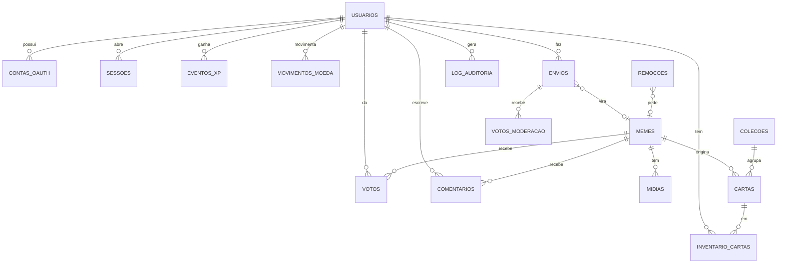
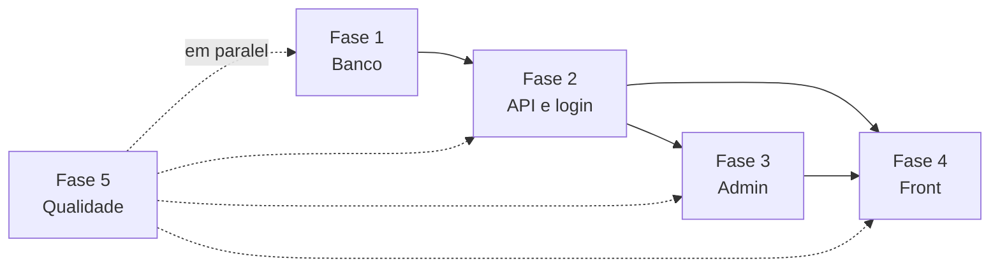

# Plano de implementação: do protótipo visual ao site funcional

Este documento reúne as etapas para transformar o protótipo visual (que roda com dados de exemplo e `localStorage`) no site de verdade: **banco de dados, API, painel admin e, por último, o front-end ligado a tudo**. A ordem importa: cada fase depende da anterior.

> Estado de partida: tag `v0.1-prototipo` (`main`). O trabalho novo acontece no branch `dev`, que publica sozinho em `naosalvo-dev.fishlab.com.br`. O `main` publica em `naosalvo-local.fishlab.com.br`.

> **Atualizado em 19/11/2026.** Fase 1 pronta em dev e prod; Fase 2 pronta no dev (acervo, economia, login com Discord); Fase 4 em andamento por fatias (carteira, XP e álbum já ligados à API; ranking e criador de gato em curso); Fase 3 (admin) ainda não começou; Fase 5 parcial. Decisões da Fase 4 em `docs/decisoes-fase4.md`. Legenda das tarefas: `[x]` feito, `[ ]` pendente, "parcial" quando falta uma parte.

> **Estado em 25/11/2026.** Produção no vp3 (`naosalvo.fishlab.com.br`), com deploy automático (GitHub Actions + Portainer em modo Git, a cada 30 min). Fases 1 e 2 prontas; Fase 3 (admin) prontas as fatias 1 a 5 e parte da 6 (ver `PLANO-ADMIN.md`); **MCP** M1 a M5 em produção (ver `PLANO-MCP.md`); Fase 4: o site lê o acervo e as cartas do banco (`viewer.js`, `GET /api/cartas`), com imagens no S3 (otimizadas para WebP); **analytics** de navegação anônimo (`nav.js`, migração 024). Próximos: teste com cliente MCP real, política do bucket (sem listagem pública), backup do bucket, aposentar `/dashboard` e o token fixo.

## Sumário

1. [Onde estamos](#1-onde-estamos)
2. [Decisões de base](#2-decisões-de-base)
3. [Fase 1 · Banco de dados](#3-fase-1--banco-de-dados)
4. [Fase 2 · API e autenticação](#4-fase-2--api-e-autenticação)
5. [Fase 3 · Painel admin](#5-fase-3--painel-admin)
6. [Fase 4 · Front-end e ajustes](#6-fase-4--front-end-e-ajustes)
7. [Fase 5 · Qualidade e operação](#7-fase-5--qualidade-e-operação)
8. [Ordem, dependências e critério de pronto](#8-ordem-dependências-e-critério-de-pronto)
9. [Decisões em aberto](#9-decisões-em-aberto)
10. [Como trabalhar no dia a dia](#10-como-trabalhar-no-dia-a-dia)

---

## 1. Onde estamos

| Parte | Hoje | Falta para ser real |
|---|---|---|
| Acervo de memes | Postgres é a fonte (75 memes, 109 cartas, seed) e já há `GET /api/memes`, `/api/eras`, `/api/categorias`; o site ainda lê o `data.js` | Ligar as telas à API e gerar o `data.js` a partir do banco |
| Contas, XP, moedas, cartas | **Servidor é a autoridade**: contas por Discord, razão de moedas e XP, estoque de pacotes e inventário no Postgres; cabeçalho e álbum já usam a API | Criador de gato salvo no servidor, boas-vindas ao concluir, recompensas sem regra (jujuba, envio aprovado, link salvo) |
| Álbum e pacotes | Sorteio no servidor, abrir/comprar/reciclar pela API, com revelação sem spoiler no front | Preço e acúmulo do diário a confirmar (seção 9 e `docs/API.md`) |
| Votos | `/api/votos` ainda lê `votos_legado` (anônima); a tabela nova `votos` é por usuário | Ligar o voto à conta, um por pessoa |
| Comentários | Tabela `comentarios` (nome digitado, não verificado) | Autor vem da conta autenticada |
| Feedback | Tabela `feedback` + lista no `/dashboard` | Ir para o admin único |
| Contribuidores | Formulário `/contribuir/` + `/dashboard` | Ir para o admin único |
| Envio de vídeos e moderação | Fila de exemplo, só no navegador | Fila no banco e decisão por consenso no servidor |
| Ranking | `GET /api/ranking?metrica=xp\|cartas` pronto (dos eventos reais); a tela ainda usa dados de exemplo | Ligar a tela (Fase 4, fatia 3) |
| Admin | `/admin` com dados fictícios | Ligado à API com permissão por patente |
| Login Google/Discord | **Discord real** (OAuth2, sessão em cookie, CSRF, patente); o site inteiro fica atrás do login. Google segue como "em breve" | Modo convidado (issue #35); `DISCORD_EXIGIR_MEMBRO=1` em produção na promoção |

O que **já é real**: API Node + Postgres modular em `/api` (acervo, economia, login, contribuidores, votos legados, feedback, comentários, links sugeridos, Sobe.Desce, Memepédia), migrações versionadas 001 a 013, seed do acervo, dois ambientes isolados, deploy automático, CI nos PRs, backup agendado 2x ao dia e segredos no Docker.

---

## 2. Decisões de base

Estas decisões valem para todas as fases. Se alguém discordar, é melhor decidir agora.

| Tema | Decisão proposta | Por quê |
|---|---|---|
| Banco | PostgreSQL, um banco por ambiente (`naosalvo`, `naosalvo_dev`) | Já existe no servidor 2 e está separado por ambiente |
| Migrações | Arquivos SQL numerados em `api/migrations/` + tabela `schema_migrations`, aplicados na subida da API | Simples, versionado, sem framework novo |
| Back-end | Continuar em Node, separando `server.js` em módulos por assunto (`auth`, `memes`, `album`, `envios`, `admin`) | O protótipo já roda assim, evita reescrever |
| Autenticação | Login com Discord (OAuth2) e sessão em cookie `httpOnly` + `SameSite=Lax` | É onde a comunidade já está e o formulário de contribuidores já pede Discord |
| Permissões | Por **patente** (Discado, Banda larga, Colaborador, Moderador, Dono de comunidade, Lenda), calculada do XP no servidor | É a regra de negócio do projeto |
| Economia | **O servidor é a autoridade**: pacotes, moedas, XP e cartas só mudam por chamadas da API, registradas num razão | Impede fraude e permite auditar |
| Imagens | Continuam em `memes/` por enquanto, com crédito. Envios de usuários vão para um armazenamento próprio (decisão na seção 9) | Não misturar acervo curado com upload de usuário |
| Dados do acervo | O Postgres vira a fonte da verdade. `data.js` passa a ser gerado/espelhado | Uma só fonte, sem duas listas divergindo |
| Linguagem | Nomes de tabela e rota em português, como já está | Consistência com o código existente |

---

## 3. Fase 1 · Banco de dados

**Objetivo:** todo dado do site vive no Postgres, com migrações versionadas e um script que carrega o acervo atual.

### 3.1 Esquema proposto

### 3.2 Tabelas, por domínio

**Contas**

| Tabela | Colunas principais | Observações |
|---|---|---|
| `usuarios` | `id`, `apelido` (único), `avatar_gato` (JSON do criador de gato), `xp`, `moedas`, `criado_em`, `ultimo_acesso`, `banido` | `xp` e `moedas` são **cache** do razão, recalculáveis |
| `contas_oauth` | `usuario_id`, `provedor` (`discord`), `provedor_id`, `nome_exibicao` | Único por `(provedor, provedor_id)` |
| `sessoes` | `id` (hash), `usuario_id`, `expira_em`, `ip`, `user_agent` | Apaga as expiradas num job |
| `patentes` | `id`, `nome`, `xp_minimo`, `permissoes` (lista) | Os 6 níveis atuais de `common.js` |

**Acervo**

| Tabela | Colunas principais | Observações |
|---|---|---|
| `memes` | `id` (slug), `titulo`, `ano`, `data`, `categoria`, `raridade`, `emoji`, `descricao`, `autor`, `duracao`, `youtube_id`, `adicionado_em`, `status` | Os campos de `data.js`. `status`: `publicado`, `oculto`, `removido` |
| `midias` | `meme_id`, `tipo` (`imagem`, `video_arquivo`), `caminho`, `credito_por`, `credito_url`, `largura`, `altura` | Substitui `img`, `vid` e `credit` |
| `eras` | `ano`, `lema`, `texto` | O `YEAR_INFO` |
| `categorias` | `nome`, `icone` | Vídeos, Cultura, TV, Música, Zoeira, Fotos, Esportes |

**Álbum e economia**

| Tabela | Colunas principais | Observações |
|---|---|---|
| `colecoes` | `id`, `nome`, `icone`, `cor`, `cores_fundo`, `sobre` | 8 coleções |
| `cartas` | `id`, `colecao_id`, `nome`, `emoji`, `raridade`, `meme_id` (opcional) | 109 cartas; só as de "Memes Icônicos" ligam a um meme |
| `inventario_cartas` | `usuario_id`, `carta_id`, `quantidade`, `primeira_em` | Repetidas viram moeda |
| `pacotes_tipo` | `id`, `nome`, `preco`, `cartas`, `chances` (JSON), `garantia` | Os tipos de pacote e as odds |
| `pacotes_abertos` | `id`, `usuario_id`, `tipo`, `cartas` (JSON), `semente`, `aberto_em` | Registro auditável de cada sorteio |
| `movimentos_moeda` | `id`, `usuario_id`, `valor` (+/−), `motivo`, `ref`, `criado_em` | Razão: o saldo é a soma |
| `eventos_xp` | `id`, `usuario_id`, `valor`, `motivo`, `ref`, `criado_em` | Alimenta patente e ranking |

**Comunidade**

| Tabela | Colunas principais | Observações |
|---|---|---|
| `votos` | `usuario_id`, `meme_id`, `curtida` (−1, 0, 1), `estrelas` (0 a 5) | Único por `(usuario_id, meme_id)`. Hoje a tabela é agregada e anônima |
| `comentarios` | `id`, `meme_id`, `usuario_id`, `texto`, `criado_em`, `oculto` | Hoje guarda só o nome |
| `feedback` | `id`, `tipo`, `msg`, `contato`, `pagina`, `usuario_id` (opcional), `criado_em`, `tratado` | Já existe |
| `contribuidores` | como hoje (nome, nick, discord, áreas, horas, experiência, ferramentas) | Já existe |

**Moderação**

| Tabela | Colunas principais | Observações |
|---|---|---|
| `envios` | `id`, `usuario_id`, `titulo`, `ano`, `categoria`, `url`, `descricao`, `status` (`aberto`, `aprovado`, `rejeitado`, `ajuste`, `duplicado`), `motivo`, `meme_id` | Fila de envio de vídeos |
| `votos_moderacao` | `envio_id`, `moderador_id`, `voto`, `motivo`, `criado_em` | Consenso de 2; desempate do Dono |
| `edicoes` | `id`, `meme_id`, `usuario_id`, `antes` (JSON), `depois` (JSON), `patrulhada_por`, `revertida` | O histórico estilo wiki |
| `remocoes` | `id`, `meme_id`, `solicitante`, `motivo`, `contato`, `status`, `prazo_em`, `respondido_por` | Prazo de 72 h |
| `log_auditoria` | `id`, `usuario_id`, `acao`, `alvo`, `detalhe` (JSON), `criado_em` | Só insere, nunca altera |

### 3.3 Tarefas

- [x] Criar `api/migrations/` e o executor de migrações (aplica em ordem, registra em `schema_migrations`, roda na subida da API). — **feito**: `api/migrate.js` com trava, checksum, `lock_timeout` e `statement_timeout`.
- [x] Escrever as migrações `001` a `00N` seguindo as tabelas acima, uma por domínio. — **feito**: migrações 001 a 013 aplicadas em dev e prod (008 economia, 009 Sobe.Desce, 010 Memepédia, 011 índice de eventos, 012 avatar do Discord, 013 perfil e cadastro).
- [x] Converter as tabelas atuais (`votos`, `comentarios`, `feedback`, `contribuidores`) por migração, **sem perder dados**. — **feito**: `votos` virou `votos_legado` e o resto foi preservado.
- [x] Script de carga `api/seed/acervo.js`: lê o `data.js` atual e preenche `memes`, `midias`, `eras`, `categorias`, `colecoes`, `cartas`, `patentes`, `pacotes_tipo`. — **feito**: carrega 75 memes e 109 cartas (a contagem subiu com os PRs da comunidade); rodar só uma vez por ambiente, ver `docs/runbook-banco.md`.
- [x] Índices: `memes(ano)`, `memes(categoria)`, `votos(meme_id)`, `comentarios(meme_id, criado_em)`, `eventos_xp(usuario_id)`, `envios(status)`.
- [ ] Backup: `pg_dump` agendado dos dois bancos, com cópia fora do servidor e um teste de restauração documentado. — **parcial**: dump agendado às 03:00 e 12:00 (Brasília) no host do servidor 2, retenção de 14 dias, restauração testada num Postgres descartável (`docs/backup-e-restauracao.md`). Falta uma cópia fora do servidor.
- [x] Testar tudo primeiro no `naosalvo_dev`; só então replicar no `naosalvo`.

**Pronto quando:** um banco vazio sobe do zero até o esquema completo só com as migrações, o seed popula o acervo, e o `naosalvo_dev` tem os mesmos 68 memes e 109 cartas que o protótipo.

---

## 4. Fase 2 · API e autenticação

**Objetivo:** rotas que o admin e o site vão consumir, com login real e permissão por patente.

### 4.1 Autenticação

- [x] Criar o aplicativo no Discord Developer Portal (um para dev e um para local) e guardar `client_id`/`client_secret` como Docker secrets. — **feito**: apps criados e segredos no Docker (`naosalvo_*_discord_*`).
- [x] Rotas `GET /api/auth/discord` (inicia), `GET /api/auth/discord/callback`, `POST /api/auth/sair`, `GET /api/eu`. — **feito**: inclui foto do Discord (`avatar_url`) e `PATCH /api/eu` para o perfil.
- [x] Sessão em cookie `httpOnly`, `Secure`, `SameSite=Lax`; proteção CSRF nas rotas que alteram dados. — **feito**: só o hash da sessão vai ao banco; `state` do OAuth assinado, IP do cliente por `TRUSTED_PROXY_HOPS`.
- [x] Primeiro login cria o usuário e o gato inicial; migrar a conta local do navegador (opcional, ver seção 9). — **feito**: a conta local do navegador foi descartada (decisão do dono).
- [x] Middleware `exigePatente("moderador")` lendo a patente do XP no servidor. — **feito**: opção de rota `{ patente }`; será usada nas rotas de moderação da Fase 3.
- [ ] O token fixo de admin atual passa a ser só "chave de emergência" e depois sai. — segue como chave de emergência até o admin da Fase 3.

### 4.2 Rotas por domínio

| Domínio | Rotas | Quem acessa |
|---|---|---|
| Acervo | `GET /api/memes`, `GET /api/memes/:id`, `GET /api/eras`, `GET /api/categorias` | Todos |
| Votos | `GET /api/votos`, `POST /api/memes/:id/voto` | Logado (1 por pessoa) |
| Comentários | `GET/POST /api/memes/:id/comentarios` | Leitura todos; escrita logado |
| Álbum | `GET /api/album`, `POST /api/pacotes/abrir`, `POST /api/pacotes/comprar`, `POST /api/album/reciclar` | Logado |
| Economia | `GET /api/carteira` (saldo e XP, do razão) | Logado |
| Ranking | `GET /api/ranking?metrica=xp\|envios\|cartas` | Todos |
| Envios | `POST /api/envios`, `GET /api/envios/meus` | Banda larga ou mais |
| Moderação | `GET /api/mod/fila`, `POST /api/mod/fila/:id/voto`, `GET /api/mod/edicoes`, `POST /api/mod/edicoes/:id/patrulhar`, `POST /api/mod/edicoes/:id/reverter` | Moderador ou mais |
| Remoções | `POST /api/remocoes` (público), `GET/POST /api/mod/remocoes` | Público / Moderador |
| Usuários | `GET /api/admin/usuarios`, `POST /api/admin/usuarios/:id/patente`, `POST /api/admin/usuarios/:id/banir` | Dono de comunidade ou mais |
| Feedback e contribuidores | rotas `/api/admin/*` que já existem | Moderador ou mais |
| Log | `GET /api/admin/log` | Moderador ou mais |

### 4.3 Regras que ficam no servidor

- [x] **Pacotes:** o sorteio usa as chances da tabela `pacotes_tipo`, grava em `pacotes_abertos` e credita cartas, moedas e XP numa só transação. A economia segue `docs/subversivo011/economia-e-escassez.md`. — **feito**: sorteio com semente gravada em `pacotes_abertos`, tudo numa transação.
- [ ] **Moedas e XP:** só mudam por linhas novas em `movimentos_moeda` e `eventos_xp`. Valores de recompensa (envio aprovado, link salvo, coleção completa) ficam numa tabela de configuração, não no código. — **parcial**: razão e cache na mesma transação, regras em `regras_economia`. Faltam as recompensas de envio aprovado, link salvo e jujuba, hoje desligadas no cliente.
- [ ] **Consenso de moderação:** 2 votos iguais fecham o envio; votos divididos esperam o desempate de um Dono. Quem votou alinhado ao resultado ganha XP. — depende da Fase 3.
- [x] **Limites:** rate limit por usuário e por IP em todas as escritas; validação de entrada em cada rota; tamanho máximo de corpo. — **feito**: rate limit por usuário e por IP, validação de entrada e `CSRF`.
- [ ] **Anti-duplicação de envio:** comparar URL normalizada e título parecido com o acervo. — depende do fluxo de envios (Fase 3).
- [x] **Documentação:** descrever as rotas num `docs/API.md` (ou OpenAPI) mantido junto do código. — **feito**: `docs/API.md`.

### 4.4 Testes

- [x] Testes automatizados com `node:test` para: migrações, permissões por patente, sorteio de pacotes (distribuição), consenso de moderação e razão de moedas. — **feito**: migrações, auth, sessão, redirect, CSRF, perfil, sorteio, razão e concorrência. Faltam os testes de consenso de moderação.
- [x] Rodar no CI a cada PR (ver Fase 5). — **feito**: jobs de sintaxe, imagens, `?v=`, testes e migrações do zero.

**Pronto quando:** dá para logar com Discord no `naosalvo-dev`, abrir um pacote e ver cartas e saldo mudarem **no banco**, e uma rota de moderação recusa quem não tem a patente.

---

## 5. Fase 3 · Painel admin

**Objetivo:** o `/admin` deixa de ser exemplo e passa a operar o site de verdade. Ele junta o `/dashboard` atual.

### 5.1 Telas do protótipo e o que cada uma precisa

| Aba do protótipo | Rotas usadas | Observações |
|---|---|---|
| Visão geral | `/api/admin/resumo` (contagens, XP do usuário, missões) | Missões e selos viram regras em tabela |
| Fila de envios | `/api/mod/fila` e voto | Consenso e desempate vêm do servidor |
| Mudanças recentes | `/api/mod/edicoes` | Diff antes/depois vem de `edicoes` |
| Remoções | `/api/mod/remocoes` | Prazo de 72 h calculado no servidor |
| Usuários e patentes | `/api/admin/usuarios` | Promover e rebaixar respeitando a patente de quem age |
| Log | `/api/admin/log` | Somente leitura |
| Regras de XP | `/api/admin/regras` | Editável só por Lenda |
| **Novas abas** | Contribuidores, Feedback, Comentários | Absorvem o `/dashboard` e permitem excluir comentários abusivos |

### 5.2 Tarefas

- [ ] Proteger `/admin` pelo login: quem não tem patente Moderador vê só uma página de acesso negado.
- [ ] Trocar os dados fictícios por chamadas à API, mantendo o visual (estados de carregando, vazio e erro).
- [ ] Remover o botão "Ver como" e o "Reiniciar exemplo".
- [ ] Mover Contribuidores, Feedback e Comentários do `/dashboard` para abas do admin e aposentar o `/dashboard` (redirecionar).
- [ ] Toda ação do painel grava em `log_auditoria`.
- [ ] Exportação CSV de contribuidores e feedback.
- [ ] Ideias já discutidas, em ordem de valor: voto cego (só ver os votos dos outros depois de votar), XP de moderação só depois da decisão se confirmar, auditoria por amostragem das decisões de moderadores novos, proteção de itens polêmicos, página de discussão por item, temporadas de ranking.

**Pronto quando:** um Moderador de verdade aprova um envio no `naosalvo-dev`, o meme aparece no acervo, o autor ganha XP e moedas, e a ação aparece no log.

---

## 6. Fase 4 · Front-end e ajustes

**Objetivo:** por último, aplicar as telas do protótipo em cima do back-end funcional.

### 6.1 Ligar as telas à API

- [ ] **Acervo:** trocar `data.js` por `GET /api/memes`, `/api/eras`, `/api/categorias` (com cache curto e fallback). — a API já existe; falta trocar o `data.js` nas telas.
- [ ] **Conta:** substituir a conta local pelo login com Discord; mostrar gato, XP, moedas e patente do servidor. O criador de gato salva o JSON no usuário. — **parcial**: login com Discord, cabeçalho com moedas, XP e patente do servidor e botão Sair prontos. Falta o criador de gato salvo no servidor e as boas-vindas ao concluir (fatia 3).
- [x] **Álbum:** pacotes, compra, reciclagem e cartas via API; as animações continuam no front, o resultado vem do servidor. — **feito**: abrir, comprar, reciclar e ler o álbum pela API, sem spoiler antes da revelação (`cliente-economia.js`).
- [ ] **Votos e comentários:** exigem login; um voto por pessoa; o autor do comentário vem da sessão (acaba a falsificação de nome).
- [ ] **Ranking:** calculado dos eventos de XP; filtros por métrica. — em andamento (fatia 3).
- [ ] **Envio de vídeos:** formulário grava em `envios`; o usuário acompanha o status.
- [ ] **Moderação no site:** a fila e o "ver como moderador" usam as mesmas rotas do admin.
- [ ] **Remoção:** o botão "Peça a remoção" do rodapé cria um registro em `remocoes` com prazo.
- [ ] **Visualizações do YouTube:** guardar a chave da YouTube Data API como secret para as visualizações reais aparecerem.

### 6.2 Ajustes pendentes conhecidos

- [ ] Álbum no celular: 8 alvos de toque abaixo de 44 px e 24 textos pequenos (home já foi corrigida).
- [ ] Link do logo no cabeçalho do celular com 31 px de altura (fica abaixo do mínimo de toque).
- [ ] Tablet e celular pequeno (360 px): conferir de novo timeline, viewer e álbum depois de ligar os dados.
- [ ] Rótulo de ~5 px cortado em dois vídeos da era Tumblr em 360 px.
- [ ] Erro de digitação na roupa do criador de gato ("Maletom", provavelmente "Moletom").
- [ ] Carregamento: imagens com `loading="lazy"`, tamanhos corretos e miniaturas, para não baixar a foto inteira na grade.
- [ ] Acessibilidade: revisar foco, nomes de botões e contraste em todas as telas, não só na home.
- [ ] SEO e compartilhamento: título, descrição e imagem de pré-visualização (Open Graph) por página e por meme.
- [ ] Páginas legais: política de privacidade e termos (hoje só o aviso legal do rodapé). Necessário antes de divulgar, por causa dos dados pessoais.
- [ ] Revisão de texto: padronizar termos (patente, nível, moedas) e remover frases de protótipo ("Em construção", "só funciona no Netlify").
- [ ] Trocar o aviso "dados de exemplo" em ranking e moderação por dados reais ou por estado vazio bem escrito.

**Pronto quando:** nenhum dado da tela vem de `data.js` nem de `localStorage` (exceto preferências como o tema), e as telas passam na checagem de celular, tablet e desktop.

---

## 7. Fase 5 · Qualidade e operação

Acontece em paralelo, mas precisa estar pronta antes de abrir ao público.

- [x] **CI (GitHub Actions) nos PRs:** checagem de sintaxe dos JS e da API, testes da Fase 2, conferência de que toda imagem citada existe em `memes/`, e um aviso quando CSS/JS mudar sem trocar a versão `?v=` dos assets. — **feito**: jobs de sintaxe, imagens, `?v=` (aviso), testes e migrações do zero.
- [ ] **Proteção do `main`:** exigir PR com aprovação. Reduz o risco do deploy automático publicar código sem revisão. — passo a passo em `docs/protecao-main.md`, ainda não aplicado.
- [x] **Modelo de PR, `CONTRIBUTING.md` e `CODEOWNERS`.** — **feito**: `CODEOWNERS` com o dono como placeholder.
- [ ] **Backups:** diários, com retenção e teste de restauração. — **parcial**: 2x ao dia (03:00 e 12:00), retenção de 14 dias e restauração testada. Falta a cópia fora do servidor.
- [ ] **Observabilidade:** `/api/health` com checagem do banco, logs do serviço e alerta quando o deployer falhar. — **parcial**: `/api/health` com checagem do banco. Faltam alerta de falha do backup e do deployer.
- [ ] **Cloudflare:** regras de cache para imagens e estáticos; revisar o modo SSL (hoje o certificado de origem é o padrão do Traefik).
- [ ] **LGPD:** base legal, retenção, exclusão de conta e de cadastro de contribuidor.
- [ ] **Antiabuso:** captcha ou verificação nos pontos públicos (comentário, feedback, formulário de contribuidor) se houver spam.
- [ ] **Segredos:** nunca no repositório; rotação do token de admin e das credenciais. — **parcial**: tudo em Docker secrets; falta a rotação do token de admin e das credenciais.
- [ ] **Promoção `dev` → `main`:** checklist de release (migrações testadas, backup feito, rollback conhecido), com tag a cada versão. — feita três vezes (PRs #11, #14 e #21) com backup antes e verificação depois; falta virar um checklist escrito.

---

## 8. Ordem, dependências e critério de pronto

| Fase | Entrega | Depende de | Como validar no `naosalvo-dev` |
|---|---|---|---|
| 1 | Esquema, migrações, seed | nada | Banco novo sobe do zero; 75 memes e 109 cartas (**pronta**) |
| 2 | API, login Discord, regras no servidor | 1 | Logar, abrir pacote, ver saldo mudar no banco (**pronta no dev**; faltam consenso de moderação e recompensas sem regra) |
| 3 | Admin real | 2 | Aprovar um envio de ponta a ponta e ver no log |
| 4 | Front ligado à API | 2 e 3 | Telas sem `data.js` nem `localStorage` de dados (**em andamento**: carteira, XP e álbum ligados; ranking e gato em curso) |
| 5 | CI, backup, observabilidade | em paralelo | PR bloqueado por teste falho; restauração testada |

**Regra de ouro:** nada vai ao `main` sem passar pelo `naosalvo-dev`. A promoção `dev` → `main` acontece por PR, com migração testada e backup feito antes.

---

## 9. Decisões em aberto

| # | Pergunta | Opções | Quem decide |
|---|---|---|---|
| 1 | Quem cria o app OAuth do Discord e em qual conta? | Conta do projeto / conta pessoal | Dono do projeto — **decidido**: o dono criou os apps de dev e de produção |
| 2 | Onde ficam os uploads de usuários (se houver upload de arquivo)? | Só links (YouTube) / MinIO próprio / Cloudflare R2 | Equipe |
| 3 | Migrar a conta local (XP, cartas) de quem já testou? | Importar uma vez no primeiro login / começar do zero | Equipe — **decidido**: começar do zero (`docs/decisoes-fase4.md`) |
| 4 | Haverá login com Google e e-mail, ou só Discord? | Só Discord / Discord + Google | Equipe — **decidido por ora**: só Discord; Google aparece como "em breve" |
| 5 | Quanto tempo guardar dados pessoais e logs? | Prazos de retenção | Dono do projeto |
| 6 | Quem pode virar Moderador e como? | Só por XP / convite do Dono / ambos | Equipe |
| 7 | O que fazer com as fotos hospedadas de terceiros? | Manter com crédito / só link / pedir autorização | Dono do projeto |
| 8 | Valores finais de XP e moedas | Revisar a tabela da economia com os dados reais | Equipe — **em aberto**: preço do pacote Clássico (150), diário acumulando até 7 e tiragem dos Míticos (`docs/API.md`) |
| 9 | A tabela `votos` atual (agregada, anônima) migra ou recomeça? | Migrar como voto "sem dono" / zerar | Equipe — **parcial**: os dados antigos foram preservados em `votos_legado`; o voto por usuário ainda não está ligado |

---

## 10. Como trabalhar no dia a dia

- **Branches:** o trabalho novo vai para `dev`. O `main` só recebe por PR vindo do `dev`.
- **Ambientes:** `dev` → `naosalvo-dev.fishlab.com.br` (banco `naosalvo_dev`). `main` → `naosalvo-local.fishlab.com.br` (banco `naosalvo`).
- **Deploy automático:** o serviço `naosalvo-deployer` publica em até ~2 minutos depois de um push. Acompanhe com `docker --context servidor2 service logs naosalvo-deployer_deployer`. Um commit que quebra o build da API não é publicado e o ambiente continua como estava.
- **Mudou a stack** (`docker-stack*.yml`) ou o deployer? O deployer usa cópias fixas em `deploy/auto/`; atualize e reconstrua `naosalvo-deployer` à mão.
- **Cache do Cloudflare:** ao alterar CSS ou JS, troque a versão `?v=` nos links de `index.html`, `album.html` e `admin/index.html`.
- **Segredos:** `.secrets/` fica fora do git. Senhas de banco e tokens de admin são Docker secrets, um conjunto por ambiente.
- **Commits:** mensagens curtas no formato `tipo(escopo): resumo`, sem trailer de co-autoria do Claude.
- **Créditos de imagens:** toda imagem de terceiros precisa de `credit` no registro e de uma linha em `docs/CREDITOS-IMAGENS.md`.
- **Documentos relacionados:** `README.md` (visão do produto, diagramas e telas), `docs/subversivo011/economia-e-escassez.md` (simulação da economia do álbum), `docs/CREDITOS-IMAGENS.md`, `docs/API.md` (contrato da API), `docs/decisoes-fase4.md`, `docs/runbook-banco.md` e `docs/backup-e-restauracao.md`.
